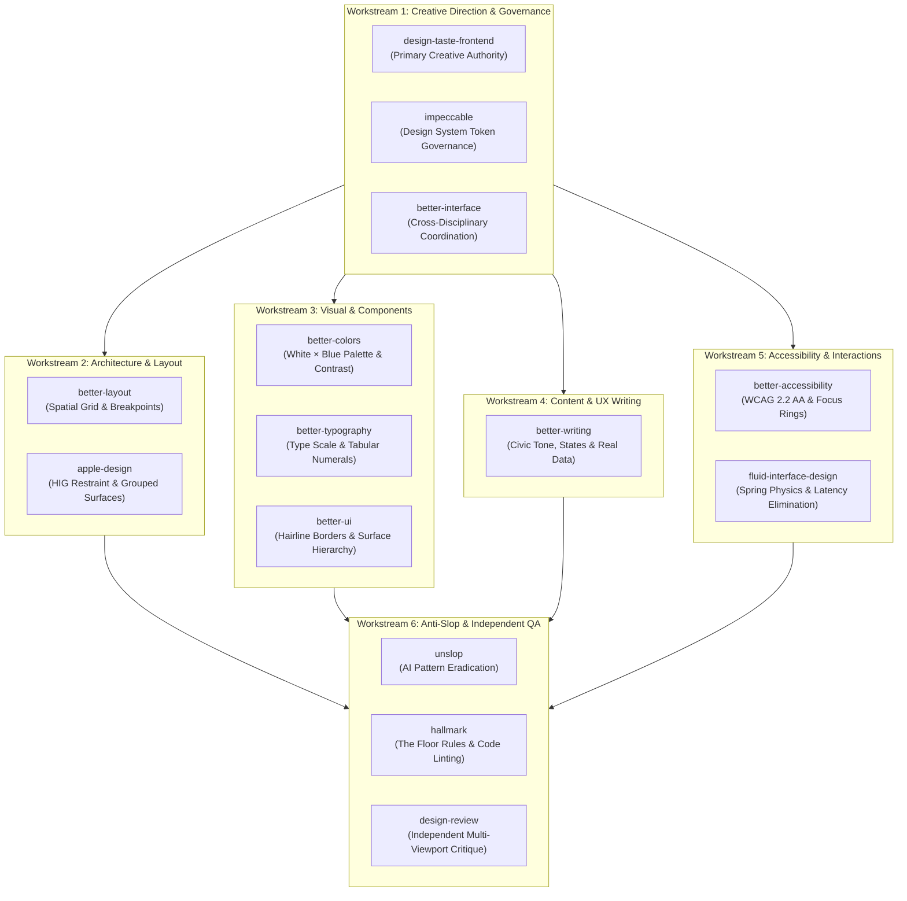

# Design Skill Workstream Allocation & Governance

**Project:** Light For Volunteer (`d:\Amaanitvam Volunteer\light-for-volunteer`)  
**Visual Identity:** The Transparent Ledger — Crisp, Architectural, Civic Azure on Pure/Ice White  
**Design Authority:** `design-taste-frontend` (Creative Direction), `impeccable` (Design System Governance), `better-interface` (Interface Coordination)  
**Date:** November 11, 2026  

---

## 1. Six Specialised Design Workstreams



---

### Workstream 1: Creative Direction & Design Governance
- **Assigned Skills:** `design-taste-frontend`, `impeccable`, `better-interface`
- **Ownership & Authority:**
  - `design-taste-frontend` is the primary creative authority for page composition, section rhythm, and the anti-slop visual standard (comparable to `figma.com` or `x.ai`).
  - `impeccable` governs design system tokens, consistency, and component architectural boundaries (`DESIGN.md`).
  - `better-interface` coordinates cross-disciplinary design evaluations across the layout, typography, colors, and accessibility.
- **Key Responsibilities:**
  - Establish distinct, non-templated page compositions tailored to each view's specific purpose.
  - Define primary visual hierarchy and user journeys.
  - Prevent conflicting design decisions between specialist workstreams.

---

### Workstream 2: Information Architecture & Responsive Layout
- **Assigned Skills:** `better-layout`, `apple-design`
- **Key Responsibilities:**
  - Structure information grouping, reading order, and density.
  - Define responsive grid behavior across 5 standard device viewports (`1440×900`, `1280×800`, `768×1024`, `390×844`, `320×800`).
  - Implement sticky navigation elements, sidebar disclosures, and slide-over mobile drawers.
  - Apply Apple HIG ergonomics: grouped card insets, thumb-reach navigation, and touch-friendly controls.

---

### Workstream 3: Visual System & Component Engineering
- **Assigned Skills:** `better-colors`, `better-typography`, `better-ui`
- **Key Responsibilities:**
  - Govern the monochromatic White × Blue color ramp (`#FFFFFF`, `#F4F9FF`, `#E0F2FE`, `#DBEAFE`, `#93C5FD`, `#0369A1`, `#075985`, `#0C4A6E`, `#0F2A43`).
  - Strict semantic color isolation: Emerald (`#047857`) for verified NGOs and active applications; Amber (`#B45309`) for review states and low openings; Rose (`#B91C1C`) for errors and expired deadlines. Zero purple, pink, or neon decorations.
  - Typographic scale enforcement: tight display tracking (`tracking-tight`), untracked body text, tabular numerals (`.tabular-nums`) for dates, hours, IDs, and metrics.
  - Component surface quality: 1px hairline sky borders (`border-[#bae6fd]`), optical icon centering via `lucide-react`, and micro-transitions on hover without `transition: all`.

---

### Workstream 4: Content & UX Writing
- **Assigned Skills:** `better-writing`
- **Key Responsibilities:**
  - Author dignified, authoritative civic copy reflecting the Amaanitvam Foundation mission.
  - Write actionable form labels, input helpers, error alerts, and empty state guides.
  - **Zero Tolerance Policy on Data Fabrication:** Never invent partner organizations, volunteer testimonials, application numbers, or fake verification stamps. All copy must respect actual product capabilities.

---

### Workstream 5: Accessibility & Interaction Engineering
- **Assigned Skills:** `better-accessibility`, `fluid-interface-design`
- **Key Responsibilities:**
  - Verify WCAG 2.2 AA contrast ratios across all backgrounds and states ($5.93:1$ to $14.2:1$).
  - Enforce explicit `:focus-visible` outlines (`#0369A1` with 2px offset) on all focusable controls.
  - Ensure minimum 44px tap targets for mobile interactive elements.
  - Ensure 16px minimum font size on inputs to prevent iOS Safari auto-zooming.
  - Eliminate interaction latency; implement physical spring feeling for drawers and disclosures.
  - Respect `prefers-reduced-motion` across all transitions.

---

### Workstream 6: Anti-Slop & Independent Quality Assurance
- **Assigned Skills:** `unslop`, `hallmark`, `design-review`
- **Key Responsibilities:**
  - **`unslop`**: Detect and eliminate AI slop tells: generic 3-card repeating grids, decorative gradient overlays, glowing blob meshes, emoji category icons, and meaningless badges.
  - **`hallmark`**: Enforce The Floor non-negotiables: declared tokens at `:root`, `overflow-x: clip`, zero `transition: all`, and above-the-fold visibility.
  - **`design-review`**: Conduct **independent visual critique** of rendered browser pages across all 5 viewports, classifying defects into Blocking, Craft, and Polish before shipping.

---

## 2. Mandatory Hierarchy of Design Authority & Conflict Resolution

When two skills or workstreams suggest divergent patterns, decisions MUST be resolved using the following strict hierarchy:

```
1. Product Requirements & Existing Application Behaviour (Highest Authority)
   ↳ API contracts, auth logic, route functionality, and database integrity must never be broken.
2. Approved White × Blue Visual Direction
   ↳ Pure White, Ice White, Civic Azure, Midnight Blue; zero arbitrary multi-color gradients.
3. design-taste-frontend
   ↳ Primary creative authority for composition, section pacing, and anti-slop fidelity.
4. impeccable
   ↳ Design system tokens, spatial grid, and architectural elevation.
5. better-interface
   ↳ Overall interface coordination and multi-disciplinary balance.
6. Specialist Workstreams (Layout, Visual, Content, Accessibility)
   ↳ Domain contributions within their respective areas of expertise.
7. design-review (Independent QA Assessment)
   ↳ Objective post-render validation and defect auditing.
```

### Conflict Resolution Examples:
- **Conflict between Animation and Accessibility:** If `fluid-interface-design` recommends a spring transition but `better-accessibility` flags a reduced-motion violation, `better-accessibility` wins.
- **Conflict between Density and Layout:** If `apple-design` suggests spacious iOS padding that causes horizontal scrolling or breaks information density in a data table, `design-taste-frontend` (The Transparent Ledger) and `better-layout` win.
- **Conflict between Visual Polish and System Tokens:** If `better-ui` suggests an ad-hoc drop shadow or gradient, `impeccable` and `unslop` override it to enforce flat elevation with hairline sky borders.
